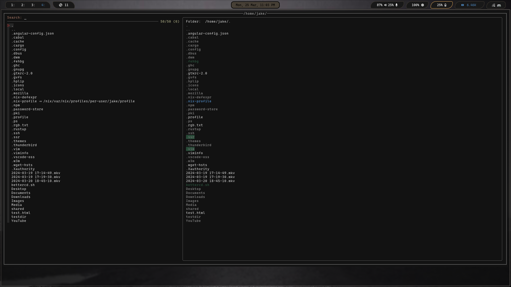

# fzfm - Fuzzy File Manager

A modern, terminal-based file manager written in Bash that uses [fzf](https://github.com/junegunn/fzf) for fuzzy finding and [lsd](https://github.com/lsd-rs/lsd) for directory listings.

## Overview

fzfm provides a lightweight, keyboard-driven file management experience. Navigate directories, preview files, and perform common file operations without leaving your terminal.



## Requirements

### Required

[](https://github.com/junegunn/fzf)
[](https://github.com/lsd-rs/lsd)

- [fzf](https://github.com/junegunn/fzf) - Fuzzy finder
- [lsd](https://github.com/lsd-rs/lsd) - Modern ls with icons

### Optional

| Tool | Purpose |
|------|---------|
| [bat](https://github.com/sharkdp/bat) | Text file preview with syntax highlighting |
| [neovim](https://neovim.io) | Text file editing |
| [chafa](https://github.com/hpjansson/chafa) | Image preview (all terminals) |
| [viu](https://github.com/atqn/viu) | Alternative image preview |
| [kitty](https://github.com/kovidgoyal/kitty) + icat | Image preview (Kitty terminal) |
| [sxiv](https://github.com/muennich/sxiv) | Image viewer |
| [zathura](https://pwmt.org/projects/zathura/) | PDF viewer |
| [libreoffice](https://www.libreoffice.org) | Document viewing |
| [mpv](https://mpv.io) | Video playback |
| [gimp](https://www.gimp.org) | XCF image editing |
| [trash-put](https://github.com/andreafrancia/trash-cli) | Trash support |
| [ffmpeg](https://ffmpeg.org) | Video thumbnail generation |

## Installation

```bash
# Clone the repository
git clone https://codeberg.org/JakeAtLinux/fzfm.git ~/.local/fzfm
cd fzfm

# Check dependencies
make check-deps

# Install (defaults to ~/.local)
make install
```

### Installation Options

| Command | Description |
|---------|-------------|
| `make check-deps` | Check for required dependencies |
| `make install` | Install to `~/.local/bin` |
| `make install PREFIX=/usr` | Install system-wide |
| `make uninstall` | Remove installed files |

### Manual Installation

```bash
# Clone the repository
git clone https://codeberg.org/JakeAtLinux/fzfm.git ~/.local/fzfm

# Add to your shell profile (~/.bashrc, ~/.zshrc, etc.)
source ~/.local/fzfm/fzfm.sh
```

## Usage

```bash
# Run fzfm
fzfm

# Show help
fzfm.sh --help

# Show version
fzfm.sh --version
```

## Keybindings

| Key | Action |
|-----|--------|
| `Enter` | Open file/folder |
| `Left` | Go to parent directory |
| `Right` | Open file/folder |
| `Space` | Toggle selection (multi-select) |
| `Alt+c` | Copy selected files |
| `Alt+m` | Move selected files |
| `Alt+p` | Paste copied/moved files |
| `Alt+r` | Rename file |
| `Alt+d` | Create directory |
| `Alt+f` | Create file |
| `Alt+t` | Move to trash |
| `Alt+Up` | Preview up |
| `Alt+Down` | Preview down |
| `Alt+s` | Play video fullscreen |
| `Alt+b` | Set as wallpaper |
| `Esc` | Clear clipboard & exit |

## Image Preview

fzfm automatically detects the best available image preview method:

1. **chafa** - Unicode art preview (works in any terminal)
2. **kitten icat** - Native protocol (Kitty terminal only)
3. **viu** - ASCII art fallback

## Clipboard Operations

- **Copy** (`Alt+c`): Stores files in `/tmp/copied` with `.copy` suffix
- **Move** (`Alt+m`): Same as copy but removes original
- **Paste** (`Alt+p`): Moves files from staging to current directory

## Troubleshooting

### Install dependencies on Void Linux

```bash
# Required
sudo xbps-install fzf lsd

# Optional
sudo xbps-install bat chafa ffmpeg trash-cli
```

### Install dependencies on Arch Linux

```bash
sudo pacman -S fzf lsd bat chafa ffmpeg trash-cli
```

### Install dependencies on Debian/Ubuntu

```bash
sudo apt install fzf lsd bat chafa ffmpeg trash-cli
```

## Configuration

No configuration file required. Edit `fzfm.sh` directly for customization.

## License

MIT License
